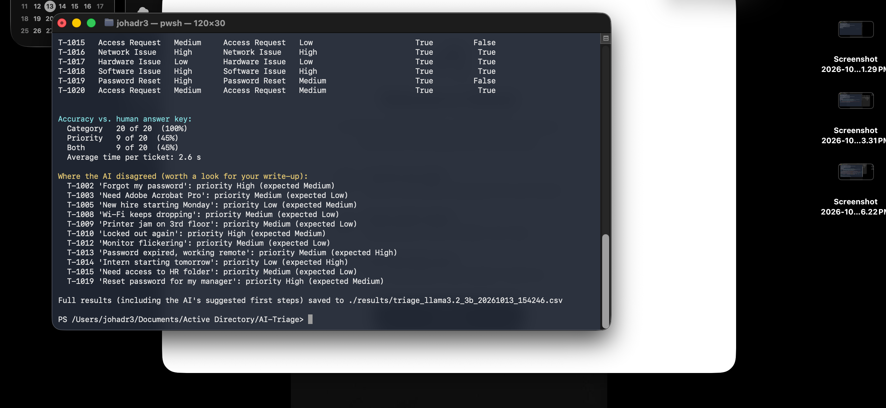

# AI Ticket Triage Experiment

**Question:** Can a small AI model running on a laptop sort helpdesk tickets the way a technician would?

`Invoke-TicketTriage.ps1` sends each ticket to a local AI model (via [Ollama](https://ollama.com)), which suggests a **category**, a **priority** and a **first troubleshooting step**. The script then compares the AI's answers with my own answer key and reports how often we agreed.

## How it works

1. `sample_tickets.csv` holds 20 realistic helpdesk tickets plus my own category and priority for each (the answer key).
2. The script sends each ticket to the model with a list of allowed categories and priority rules.
3. A JSON schema forces the model to answer in a fixed format using only the allowed values, so the results can be scored automatically.
4. Temperature is set to 0 so the same ticket always gets the same answer, which makes the results repeatable.
5. The script prints accuracy, lists every disagreement, and saves the full results (including suggested first steps) to CSV.

```powershell
ollama pull llama3.2:3b
./Invoke-TicketTriage.ps1 -CsvPath ./sample_tickets.csv
./Invoke-TicketTriage.ps1 -CsvPath ./sample_tickets.csv -Model llama3.1:8b   # compare another model
```

## Results

Model: **llama3.2:3b** running locally on a MacBook (8 GB RAM) through Ollama.

| Model | Category accuracy | Priority accuracy | Both correct | Avg. time per ticket |
|---|---|---|---|---|
| llama3.2:3b | **20 of 20 (100%)** | 9 of 20 (45%) | 9 of 20 (45%) | 2.6 s |



### What the AI got wrong, and why

**Category was perfect, priority was a coin flip.** The model correctly told apart look-alike tickets such as *Account Lockout* vs. *Password Reset*, and *Software Issue* vs. *Software Request*. Priority was the weak spot, and the misses followed two clear patterns:

- **It missed deadlines and business impact.** It rated "Intern starting tomorrow" (T-1014) as Low and "Password expired, working remote" (T-1013) as Medium, but both block someone from working right away. Priority depends on context like *who* is affected and *when*, which a short ticket doesn't always spell out.
- **It almost never used Low.** Minor issues like a flickering monitor (T-1012), a printer jam with other printers working (T-1009) and a software request with no deadline (T-1003) were all bumped up to Medium. A real queue triaged this way would look more urgent than it is.

**The answer key isn't perfect either.** For T-1019, someone asking IT to reset their manager's password and text it to them, the AI said High and I said Medium. Because that request is a classic social-engineering pattern, the AI's answer is arguably the better one. Grading AI output makes you re-examine your own judgment too.

### Would I use this at work?

**Yes for routing, no for priority.** At 100% category accuracy and under 3 seconds per ticket, it could pre-sort a queue so tickets reach the right team faster. Priority should stay a human decision, or the model should only *suggest* it, with a technician confirming.

**Next experiment:** add priority examples to the instructions (few-shot prompting) and compare a larger model (`llama3.1:8b`) to see whether priority accuracy improves.

## Responsible AI use

- **Runs locally.** The model runs on my own computer through Ollama, so no ticket data is sent to an outside service.
- **Fake data only.** All tickets, names and details are made up.
- **Human in the loop.** The AI only suggests. A technician makes the final call on category, priority and the fix.
- **Measured, not assumed.** Accuracy is checked against a human answer key before trusting the tool.
