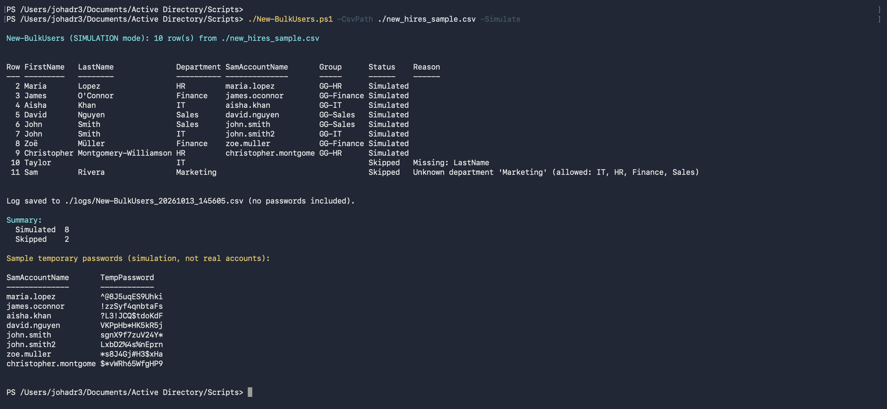

# Active Directory Home Lab

A virtualized Windows Server environment built to practice real helpdesk and system administration work: user and group management, Group Policy, file share permissions, ticketing, PowerShell automation and AI-assisted ticket triage.

> 🚧 **In progress.** This README grows as each phase of the lab is completed.

## Lab overview

| Machine | Role | OS |
|---|---|---|
| DC01 | Domain controller: AD DS, DNS, DHCP, NAT | Windows Server 2022 |
| CLIENT01, CLIENT02 | Domain-joined workstations | Windows 11 |
| HELPDESK01 | osTicket ticketing system | Ubuntu Server |

Domain: `corp.lab.local` · Network: `10.0.0.0/24`

<!-- Add diagrams/network-diagram.png here -->

## Skills demonstrated

Active Directory · Group Policy · Windows Server 2022 · PowerShell · DNS / DHCP · NTFS permissions · Ticketing · Documentation · AI-assisted automation

## Automation

### `Scripts/New-BulkUsers.ps1`: new-hire onboarding

Creates user accounts in bulk from a CSV exported by HR.

- Builds standard usernames (`first.last`) and handles duplicates (`john.smith2`), accents (`Zoë Müller` → `zoe.muller`), punctuation (`O'Connor` → `oconnor`) and the 20-character limit
- Places each user in their department's OU and security group (`GG-<Department>`)
- Sets a random temporary password that must be changed at first logon
- Skips bad rows with a clear reason (missing fields, unknown department) instead of failing the whole run
- Logs every row to CSV; passwords are never written to the log
- Supports `-WhatIf` to preview changes, and a `-Simulate` mode that runs on any computer without Active Directory

```powershell
# Preview on any machine (including macOS with PowerShell 7)
./Scripts/New-BulkUsers.ps1 -CsvPath ./Scripts/new_hires_sample.csv -Simulate

# On the domain controller
.\Scripts\New-BulkUsers.ps1 -CsvPath .\new_hires.csv -WhatIf   # preview
.\Scripts\New-BulkUsers.ps1 -CsvPath .\new_hires.csv           # create accounts
```



## What I learned

<!-- Fill in as you go: problems you hit and how you fixed them. Reviewers read this section. -->
